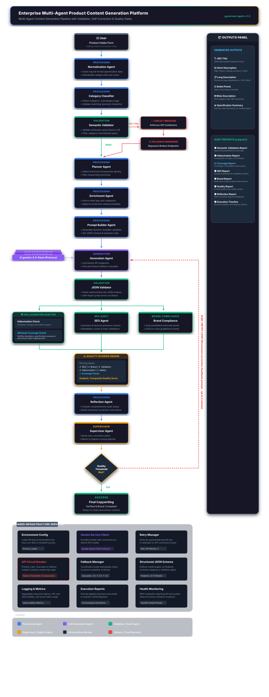

# Enterprise Multi-Agent Product Content Generation Platform

<p align="center">
  <strong>A Governed E-commerce Merchandising Pipeline with AI Validation and Self-Correction</strong>
</p>

<p align="center">
  
  
  
  
  
  
  
  
  
</p>

> **Live demo:** _add your Streamlit URL here_ · **API docs:** _add your Render URL_/docs · See [DEPLOYMENT.md](DEPLOYMENT.md) to deploy your own.

---

## 🎨 Architecture Diagram

Below is the complete system design, runtime execution order, and modular data flows of the platform:



---

## 🤖 Agentic Architecture

This is an **agentic system with deterministic guardrails**: LLM agents decide *what to do*, and rule-based validators decide *whether the result is acceptable*.

| Agent | Type | What it decides |
|---|---|---|
| **Planner** (`agents/planner.py`) | LLM (falls back to rules) | Writing strategy, keyword placement, and product-specific risks. On retries it **replans** from audit weaknesses and the supervisor's directive. |
| **Writer** (`agents/writer.py`, `tool_loop.py`) | LLM + **tool calling** | Drafts copy, then *chooses* which tools to call (`get_verified_facts`, `check_hallucination`, `check_brand_rules`, `check_seo`, `get_category_guidance`), reads results, and revises before submitting. Capped at `AGENT_MAX_TOOL_STEPS`. |
| **Supervisor advisor** (`agents/supervisor.py`) | LLM inside guardrails | After a failed audit, chooses `regenerate` (with a root-cause directive) or `escalate` to human review. |

**Guardrails that keep it safe**
- The LLM can **never accept** a failing draft: pass/fail is decided by the deterministic hallucination, SEO, and brand engines.
- Escalation is allowed only after at least one correction attempt; unknown actions default to `regenerate`.
- Every agentic component **degrades gracefully**: tool loop fails → classic single-shot generation; planner fails → rule-based plan; advisor fails → plain regenerate.
- Hard caps on tool steps, retries, and per-call timeouts.

**Observability:** the full tool-call trace (tool, arguments, result, timing, attempt) is returned in `metadata.agent_trace` and shown in the Streamlit **Agent Trace** panel.

**Configuration** (`.env`): `AGENTIC_MODE`, `AGENT_MAX_TOOL_STEPS`, `AGENT_STEP_TIMEOUT`, `LLM_PLANNER_ENABLED`, `LLM_SUPERVISOR_ENABLED`. Set `AGENTIC_MODE=false` to run the original deterministic pipeline (useful for A/B comparison).

**Tests:** `app/tests/test_agentic.py` uses a scripted fake Gemini client to test tool calling, budget limits, fallbacks, supervisor guardrails, and two full end-to-end LangGraph runs offline (no API key needed).

---

## 📊 Sample Pipeline Execution

Below is a typical audit summary showing execution telemetry and compliance verification metrics from a successful end-to-end run:

*   **✓ 14 LangGraph nodes executed** — 3 LLM agents (Planner, tool-using Writer, Supervisor advisor) + deterministic validators
*   **✓ Semantic Validation**: PASS
*   **✓ Hallucination Score**: 100 / 100
*   **✓ SEO Score**: 90 / 100
*   **✓ Brand Compliance**: 100 / 100
*   **✓ Safety Score**: 100 / 100
*   **✓ Overall Quality**: 97.5 / 100
*   **✓ End-to-End Runtime**: 35.9 seconds

---

## ⚠️ Problem Statement

In enterprise e-commerce, automated content generation at scale introduces severe operational risks. Traditional Large Language Models (LLMs) running without guardrails frequently suffer from:
*   **Hallucinations**: Inventing product parameters (such as battery life, weights, or dimensions) not found in the source specifications.
*   **Brand Non-Compliance**: Using prohibited marketing buzzwords (e.g., "ultimate", "revolutionary") that trigger legal liabilities.
*   **Category Contradictions**: Describing smartwatch features (e.g., "heart rate tracking") for automobiles, or vice versa, due to context-free prompting.
*   **JSON Schema Corruption**: Failing to return valid JSON formats, breaking backend database parsers and downstream intake systems.

---

## 💡 Why This Platform Exists

This platform was built to transform LLM-driven generation from an experimental tool into a **robust merchandising engine with automated guardrails**. By decoupling the frontend and backend, it introduces:
1.  **Deterministic Pre-processing Gates**: Sanitizing and validating catalog data before it ever reaches the LLM.
2.  **Category-Aware Semantic Validation**: Enforcing that attributes specifically belong to the product category or detected subcategory.
3.  **Attribute Coverage Auditing**: Mapping the presence of required attributes and package contents in the generated copywriting using fuzzy matching to minimize omissions.
4.  **Post-Generation Auditing**: Comparing the model's copywriting output against original inputs to detect and prevent unsupported AI-generated claims.
5.  **Automatic Self-Correction**: Providing a structured feedback retry loop that runs up to 3 times to correct issues autonomously.

---

## 🧩 Solution Overview

The platform uses a **completely decoupled architecture** consisting of a Streamlit frontend client communicating over REST with a FastAPI backend service.

The backend orchestrates a **directed multi-agent workflow using LangGraph** containing the following processing nodes and compliance audit gates:
1.  **Normalization**: Standardizes raw text, abbreviations, weight metrics, and dimensions.
2.  **Category & Subcategory Classification**: Deterministically detects the category and keyword-matching subcategory (e.g. `Smartwatch`).
3.  **Basic & AI Semantic Validation**: Runs structural bounds checks and calls the Gemini API under Pydantic schemas to filter category-mismatched specs.
4.  **Product Enrichment**: Generates secondary derived tags based on the product category.
5.  **Prompt Selection**: Resolves prompt templates from the category template registry.
6.  **Dynamic Prompt Builder**: Assembles the prompt context, injecting validated parameters and setting rejected ones as `FORBIDDEN CLAIMS`.
7.  **Gemini AI Generation**: Executes text generation with timeout cancels, retry limits, and automatic model fallback chains.
8.  **JSON Validation**: Asserts that the copy is parsed into clean, structured dictionaries.
9.  **Compliance Audits**: Evaluates hallucination, SEO keyword presence, and brand word scans in parallel.
10. **Quality Scoring**: Computes overall quality, safety sub-scores, and identifies risks.
11. **Self-Correction Feedback**: Triggers retries using error context prompts if quality thresholds fail.

---

## 🏢 Enterprise Features

*   **Priority Credentials Loading**: Supports automatic API key initialization resolving from environment variables, Streamlit secrets, or local `.env` files.
*   **Circuit Breaker Protection**: Tracks consecutive API failures per model to bypass broken endpoints and cascades to fallback models automatically.
*   **Comprehensive Caching**: Embeds a thread-safe, 15-minute TTL cache on semantic validation to prevent redundant LLM billing.
*   **Token & Cost Observability**: Tracks input/output token counts and estimates USD transaction costs in real-time.
*   **Chronological Decision Timeline**: Logs every governance decision with exact timestamps for traceability.

---

## 🛡️ AI Governance Capabilities

*   **Pydantic Structured Validation**: Uses `response_schema` in the validator engine to guarantee structurally clean, parseable JSON arrays.
*   **Slang & Vulgarity Filters**: Pre-scans and filters unacceptable vocabulary during input validation.
*   **Slang/Context Brand Scanning**: Catches restricted advertising terms and ensures voice/tone compliance.
*   **Prompt Injection Detection**: Blocks jailbreak patterns (like "ignore previous instructions") at the gate.

---

## 🔬 Quality Assurance Pipeline

### 1. Attribute Validation Engine
Splits validation into Stage 1 (required fields, types, and bounds) and Stage 2 (AI Semantic validation). If Gemini is unavailable, it returns a `DEGRADED` status and sets the accepted features list to empty (`accepted=[]`), preventing silent passes of unvalidated parameters.

### 2. Composite Safety Score (5-Dimension Audit)
Calculates a safety score based on the following dimensions:
*   **Content Safety (30%)**: Penalized by AI hallucinations.
*   **Brand Safety (20%)**: Penalized by restricted word violations.
*   **Category Safety (20%)**: Penalized by rejected user attributes.
*   **Validation Safety (15%)**: 0% if validator status is `DEGRADED`, else penalized by warnings.
*   **Policy Safety (15%)**: Penalized if any High-severity hallucination is detected.

### 3. Attribute Coverage Audit
Ensures that all mandatory input attributes and specified `package_contents` items are present in the final copy, filtering out short helper words (length <= 2) to prevent false substring matches.

### 4. Self-Correction Loop
If the Quality Score is $< 85\%$ or the Safety Score is $< 100\%$, the `CorrectionPromptBuilder` compiles a detailed error log and redirects the prompt back to Gemini. It runs for up to 3 attempts, ultimately returning the highest-scoring version.

---

## 💻 Technology Stack

| Layer | Component | Technology |
|---|---|---|
| **Frontend** | UI Rendering & Tabs | Streamlit 1.59 |
| **Backend API** | Web Server & Routing | FastAPI 0.115, Uvicorn 0.34 |
| **AI Workflow** | Graph Orchestration | LangGraph 0.2.69 |
| **AI Client** | LLM Engine Client | Google Gemini API (via `google-genai` 2.11) |
| **Validation** | Data Models & Schemas | Pydantic v2.12, `pydantic-settings` 2.8 |
| **HTTP Client** | Communications | requests 2.33 |
| **Testing** | Unit Tests | pytest 9.1 |
| **Storage** | Persistence | Local JSON filesystem (`outputs/`) |

---

## 📂 Project Structure

```
product-content-platform/
│
├── streamlit_app.py              ← Frontend UI Client
├── requirements.txt              ← Dependency requirements
├── architecture_diagram.svg      ← Solution Architecture Diagram
├── Dockerfile
├── docker-compose.yml
│
└── app/                          ← FastAPI Backend Service
    ├── main.py                   ← Application entry point & Startup
    │
    ├── agents/                   ← Multi-Agent Implementations
    │   ├── base.py               ← Base Agent class
    │   ├── planner.py            ← Planner Agent
    │   ├── reflection.py         ← Reflection Agent
    │   └── supervisor.py         ← Supervisor Agent
    │
    ├── api/routes/
    │   ├── generate.py           ← POST /generate router
    │   ├── health.py             ← GET /health router
    │   └── reports.py            ← GET /report/{id} router
    │
    ├── core/
    │   ├── config.py             ← Environment config manager
    │   ├── gemini_service.py     ← Shared Gemini client instance
    │   ├── circuit_breaker.py    ← Resiliency Circuit Breaker
    │   ├── request_logger.py     ← System observability manager
    │   ├── exceptions.py         ← Custom Exceptions
    │   ├── constants.py
    │   └── brand_rules.json      ← Brand compliance configurations
    │
    ├── engines/
    │   ├── normalizer.py         ← Input sanitization engine
    │   ├── classifier.py         ← Category & Subcategory classification
    │   ├── validator.py          ← Basic & AI Semantic Validator
    │   ├── validator_prompt.py   ← Validation prompt schemas
    │   ├── enrichment.py         ← Tags enrichment engine
    │   ├── prompt_builder.py     ← Dynamic Prompt builder
    │   ├── prompt_registry.py    ← Template resolution loader
    │   ├── generator.py          ← Core Gemini caller
    │   ├── json_validator.py     ← Generated copy parser
    │   ├── hallucination.py      ← Hallucination checker
    │   ├── comparison_engine.py  ← Specs matching engine
    │   ├── seo.py                ← Keyword density auditor
    │   ├── brand.py              ← Voice & tone scan
    │   ├── scoring.py            ← Weighted Quality & Safety scores
    │   └── correction.py         ← Self-Correction prompt compiler
    │
    ├── orchestrator/             ← LangGraph Workflows
    │   ├── builder.py            ← Workflow graph builder
    │   ├── graph.py              ← Compiled graph interface
    │   ├── graph_state.py        ← GraphState dictionary type
    │   ├── nodes.py              ← Graph nodes wrappers
    │   ├── orchestrator.py       ← Graph compiler & invoke wrapper
    │   ├── orchestrator_legacy.py ← Legacy sequential flow coordinator
    │   ├── registry.py           ← Registry for nodes mapping
    │   └── routers.py            ← Supervisor route logic helpers
    │
    ├── models/
    │   ├── product.py            ← Product Pydantic model
    │   ├── response.py           ← API Response Pydantic models
    │   └── reports.py            ← Audit Reports Pydantic models
    │
    ├── prompts/                  ← Category prompt templates
    │   ├── footwear_v1.txt
    │   └── electronics_v1.txt
    │
    └── tests/                    ← Test Suites (23 tests total)
        ├── test_pipeline.py      ← Test suite for orchestrated graph flows
        └── test_validation_pipeline.py  ← Test suite for validators & engines
```

---

## 🚀 Installation

### 1. Clone the repository
```bash
git clone https://github.com/kammala-kalyan/AI-Product-Content-Generation-Platform.git
cd AI-Product-Content-Generation-Platform
```

### 2. Set up virtual environment
```bash
python -m venv venv
# Windows
venv\Scripts\activate
# macOS / Linux
source venv/bin/activate
```

### 3. Install dependencies
```bash
pip install -r requirements.txt
```

### 4. Set environment configuration
Create a `.env` file in the root directory (or in `backend/`):
```env
GEMINI_API_KEY=AIzaSy...
GEMINI_MODEL=gemini-3.5-flash
BACKEND_URL=http://127.0.0.1:8000
```

### 5. Start Backend API
```bash
python -m uvicorn app.main:app --reload --host 127.0.0.1 --port 8000
```

### 6. Start Frontend Dashboard
Open a new terminal (with active venv):
```bash
streamlit run streamlit_app.py
```

---

## ⚡ Quick Start

Access the live web application here:  
🌐 **Live Demo:** [genai-merchandising.streamlit.app](https://genai-merchandising.streamlit.app/)

---

## 🐳 Deployment & Containerization

The platform is designed to be fully containerized using **Docker** and **Docker Compose** to support cloud-agnostic microservice deployments.

### 1. Docker Build Configuration (`Dockerfile`)
The unified `Dockerfile` leverages a lightweight `python:3.12-slim` base image, installs system requirements, copies clean dependencies, and exposes ports for both microservices:
*   **FastAPI Backend Port**: `8000`
*   **Streamlit Frontend Port**: `8501`

### 2. Multi-Container Orchestration (`docker-compose.yml`)
The orchestration configuration coordinates two services linked via internal bridge networking:
*   **`backend` service**: Runs FastAPI via Uvicorn, binds port `8000:8000`, mounts the `/outputs` directory as a volume, and loads `.env` variables.
*   **`frontend` service**: Runs the Streamlit dashboard on port `8501:8501`, binds environment parameters, and configures `depends_on` to ensure the backend starts first.

To run the entire platform locally using Docker:
```bash
# Build images and start microservices in the background
docker-compose up --build -d
```
*   **Dashboard access**: `http://localhost:8501`
*   **API Docs access**: `http://localhost:8000/docs`

### 3. Production Cloud Deployments
*   **Backend Hosting (Render)**: Connect the repository as a **Web Service**, set the Start Command to `uvicorn app.main:app --host 0.0.0.0 --port $PORT`, and configure `GEMINI_API_KEY` in Render environment variables.
*   **Frontend Hosting (Streamlit Cloud)**: Deploy as a Streamlit application, define the main file path as `streamlit_app.py`, and add secrets config (`BACKEND_URL`, `GEMINI_API_KEY`) under App Settings.

---

## 🔮 Future Enhancements

*   **Automatic SEO Keyword Suggestion**: Querying Google Search Console or SEMrush APIs to dynamically populate high-value keyword targets.
*   **Multi-Modal Image Validation**: Using Gemini Vision to check if the generated copy matches the uploaded product image colors/material.
*   **Human-in-the-Loop publishing workflow**: A staging interface allowing merchandisers to manually edit reports and publish directly to Shopify/Magento endpoints.

---

## ✍️ Author

*   **Kammala Kalyan** — [GitHub Profile](https://github.com/kammala-kalyan)
